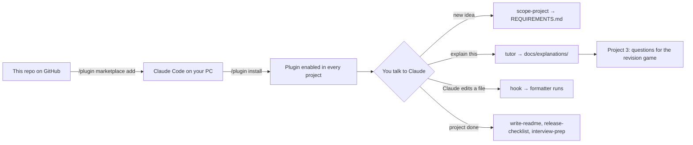

# Plan: Project 0, `claude-dev-toolkit`

A personal Claude Code plugin that you build once and use in every other project. It turns your way of working (scope → build → understand → ship → revise) into reusable tools, so you never have to repeat the same instructions to Claude.

**Time:** 1 day for the first version (≈ 8 h of focused work), then small improvements after each project.

**Progress:** ✅ Step 1 · ⬜ Step 2 · ⬜ Step 3 · ⬜ Step 4 · ⬜ Step 5 · ⬜ Step 6 · ⬜ Step 7

---

## 1. What you'll have at the end

- A public GitHub repo that anyone can install with two commands:
  ```
  /plugin marketplace add E54Sacha/claude-dev-toolkit
  /plugin install claude-dev-toolkit@claude-dev-toolkit
  ```
- Inside it:

| Piece | Type | What it does for you |
|---|---|---|
| `scope-project` | 📘 Skill | Asks you questions about an idea, then writes `REQUIREMENTS.md` (must / nice-to-have / out of scope, day-by-day plan, definition of done) |
| `tutor` | 🤖 Subagent | Explains code Claude just wrote: concepts, why this approach, pros and cons, alternatives, key snippets. Saves each explanation to `docs/explanations/` |
| `write-readme` | 📘 Skill | Writes a standard README: pitch, demo GIF slot, Mermaid diagram, how to run, what I learned |
| `learning-log` | 📘 Skill | At the end of a session, adds what you learned to `LEARNINGS.md` |
| `interview-prep` | 📘 Skill | Reads your code, asks you 10 interview questions one at a time, grades your answers |
| `release-checklist` | 📘 Skill | Walks through version bump, changelog, git tag, build, publish |
| Format hook | 🪝 Hook | After every file Claude edits, runs the right formatter automatically |

---

## 2. How it works

### The pieces, in plain words

- A **skill** is a folder with a `SKILL.md` file: a short description at the top, then instructions. Claude only reads the description at first. When your request matches it ("let's scope a new project"), it loads the full instructions. You can also call it directly: `/claude-dev-toolkit:scope-project`.
- A **subagent** is a separate Claude with its own instructions and a limited set of tools. The main Claude hands it a task ("explain the auth code"), it works in its own context, and returns a result. This keeps long explanations out of your main conversation.
- A **hook** is a command that Claude Code runs by itself on an event. Here: "after every Edit or Write, run the formatter on that file". Claude doesn't decide to run it, the tool does, so it never forgets.
- A **plugin** is the box that holds all of the above, with a `plugin.json` file describing it.
- A **marketplace** is a `marketplace.json` file that lists plugins. Putting one at the root of the repo makes the repo itself installable.

### The flow



### Repo structure

```
claude-dev-toolkit/
├── .claude-plugin/
│   ├── plugin.json            # name, version, description, author
│   └── marketplace.json       # makes the repo installable
├── skills/
│   ├── hello/SKILL.md         # smoke test (step 1), removed at step 7
│   ├── scope-project/
│   │   ├── SKILL.md
│   │   └── template.md        # the REQUIREMENTS.md template
│   ├── write-readme/
│   │   ├── SKILL.md
│   │   └── template.md        # the README template
│   ├── learning-log/SKILL.md
│   ├── interview-prep/SKILL.md
│   └── release-checklist/SKILL.md
├── agents/
│   └── tutor.md
├── hooks/
│   ├── hooks.json             # "after Edit/Write, run format.mjs"
│   └── format.mjs             # picks the formatter from the file extension
├── tests/
│   └── format.test.mjs        # tests for the hook script (step 6)
├── README.md
├── CHANGELOG.md
└── LICENSE
```

### The dev loop you'll repeat at every step

1. Claude writes or edits a file in `skills/`, `agents/` or `hooks/`.
2. You make Claude Code reload it: restart Claude Code (if changes don't show up, run `/plugin marketplace update claude-dev-toolkit`, then restart).
3. Optional check: `claude plugin validate .` from the repo folder catches broken manifests and frontmatter.
4. You run the test prompts listed in the step's **Test checklist**.
5. If something is off, you tell Claude what was wrong, it edits, back to 2.
6. When the checklist passes: one commit per step (`git commit -m "Add scope-project skill"`).

---

## 3. The steps

Each step has: **sub-tasks** (who does what), **file contents** (the key parts, not every word), a **test checklist** (what to type, what you should see), and **concepts** (what you learn, with self-check questions). Do them in order: each one is testable before moving on.

---

### Step 1: Skeleton plugin, installed locally ✅ DONE

> **Summary:** Create the smallest plugin that Claude Code can load: the two manifest files and one "hello" test skill. It proves the install path works before you write any real feature. **Result:** the plugin installs locally and `/claude-dev-toolkit:hello` answers.

**Created:**
- `.claude-plugin/plugin.json`: name `claude-dev-toolkit`, version `0.1.0`, description, author `E54Sacha`, repo URL, license `MIT`.
- `.claude-plugin/marketplace.json`: marketplace named `claude-dev-toolkit`, one plugin with `"source": "./"` (the plugin is the repo itself).
- `skills/hello/SKILL.md`: replies with a fixed "✅ claude-dev-toolkit is loaded" message.

**Verified:** the plugin is installed, `claude-dev-toolkit:hello` shows up in the skill list and runs.

**Leftovers:**
- [x] Add a `LICENSE` file (MIT), since `plugin.json` already says MIT. Committed as `a184e8e Add MIT license`.
- [x] Add a License section to the README. Committed as `ad91543 Add license section to README`.
- [ ] Commit the skeleton: `git add .claude-plugin skills PLAN.md && git commit -m "Add plugin skeleton and hello skill"`.
- [ ] Push to GitHub (the repo stays private until Step 7).

**Concepts:**
- `plugin.json` describes **one plugin**; `marketplace.json` is a **catalog** that can list many. Here the repo is both at once.
- Claude Code finds components by folder convention: `skills/*/SKILL.md`, `agents/*.md`, `hooks/hooks.json`. No registration code.
- Plugin skills are namespaced: `/claude-dev-toolkit:hello`, so they never clash with another plugin's `hello`.

**Self-check:** Why does the marketplace say `"source": "./"`? What would change if the plugin lived in a `plugins/toolkit/` subfolder?

---

### Step 2: `scope-project` skill (≈ 1.5 h)

> **Summary:** Write the skill that turns a vague idea into a clear `REQUIREMENTS.md`. It asks you grouped questions first, pushes back if the scope is too big for the time you have, then fills a fixed template. Every later project starts with it. **Result:** a one-line idea becomes a plan you'd actually follow.

**Sub-tasks:**

| # | Who | Task | Time |
|---|---|---|---|
| 2.1 | Claude | Write `skills/scope-project/template.md` (the REQUIREMENTS.md template below) | 10 min |
| 2.2 | Claude | Write `skills/scope-project/SKILL.md` (frontmatter + 4 phases below) | 20 min |
| 2.3 | You | Run it on Project 1 (portfolio) in an empty test folder | 20 min |
| 2.4 | You | Note what was wrong: questions missing, too many, plan unrealistic | 10 min |
| 2.5 | Claude | Fix the skill from your notes | 15 min |
| 2.6 | You | Run it again on a different idea (Project 4, CHIP-8) to check it's not overfitted to the portfolio | 15 min |

**`SKILL.md`, key parts:**

```markdown
---
name: scope-project
description: Turns a project idea into a REQUIREMENTS.md by asking questions first. Use when the user wants to scope, plan, or start a new project, says "new project idea", "plan this", "what should v1 include", or describes an app they want to build.
---

# Scope a project

## Phase 1: Understand (ask, don't write)
Ask ALL these questions in ONE grouped message (use the question tool if available),
each with your recommendation:
1. Goal: what problem does it solve, for whom?
2. Why: portfolio piece, learning, real users?
3. Must-haves (max 5), nice-to-haves, explicitly out of scope
4. Time budget (days, hours per day)
5. Tech constraints: imposed stack, platforms, hosting, budget
6. Definition of done: what must work in the demo?
Do not write any file during this phase.

## Phase 2: Challenge
Estimate each must-have in hours. If the total exceeds the time budget by >20%,
say so and propose what to cut or move to nice-to-have. Wait for the answer.

## Phase 3: Write
Fill template.md (same folder as this file) and save it as REQUIREMENTS.md
at the project root. If one exists, ask before overwriting.

## Phase 4: Hand off
Show a 5-line summary and ask: "Start day 1?"
```

**`template.md`, sections:**

```markdown
# <Project name>: Requirements
> One-sentence pitch.

## Goal and audience
## Must-have (v1)            ← each with an estimate in hours
## Nice-to-have (v1.1+)
## Out of scope              ← things you'll be tempted to add but won't
## Tech stack                ← each choice with one line of "why"
## Day-by-day plan           ← Day 1 / Day 2 / Day 3, each ending on something demoable
## Definition of done        ← checkboxes, all testable
## Risks                     ← risk → what to do if it happens
```

**Test checklist:**

| Type this | You should see |
|---|---|
| "I have an idea: a personal portfolio website" (no slash command) | The skill triggers by itself, asks grouped questions, **no file written yet** |
| Answer with a scope that's clearly too big for 2 days | Claude pushes back and proposes cuts |
| Accept the cuts | `REQUIREMENTS.md` appears, every section of the template filled |
| `/claude-dev-toolkit:scope-project` in a folder that already has a REQUIREMENTS.md | It asks before overwriting |
| "fix this typo in my code" | The skill does **not** trigger |

**Concepts:**
- **Progressive disclosure:** only the `description` is always in Claude's context; the body loads when needed, `template.md` only when Phase 3 reads it. That's why skills are cheap even when you have dozens.
- **The description decides triggering.** It must contain the words you actually type. Bad: "Project scoping helper." Good: the one above.
- Phases with explicit "wait" points stop Claude from rushing to write files.

**Self-check:** Why put the template in a separate file instead of inside `SKILL.md`? What happens if two skills have overlapping descriptions?

---

### Step 3: `tutor` subagent (≈ 1.5 h)

> **Summary:** Create a separate Claude whose only job is to explain code to you: concepts, why this approach, alternatives, key snippets and 3 quiz questions. It works in its own context, so your main conversation stays short, and it can only write in `docs/explanations/`. **Result:** you understand code you didn't write, and each explanation is saved for later revision.

**Sub-tasks:**

| # | Who | Task | Time |
|---|---|---|---|
| 3.1 | Claude | Write `agents/tutor.md` (frontmatter + explanation template) | 25 min |
| 3.2 | You | Pick code you didn't write (e.g. `hooks/format.mjs` later, or any open-source file) and ask the tutor to explain it | 20 min |
| 3.3 | You | Read the explanation, then try to answer its 3 quiz questions without looking | 15 min |
| 3.4 | Claude | Adjust: too long? too shallow? jargon not explained? | 15 min |
| 3.5 | You | Check the file landed in `docs/explanations/` with the right name | 5 min |

**`agents/tutor.md`, key parts:**

```markdown
---
name: tutor
description: Explains code to a junior developer so they truly understand it. Use when the user asks to explain, teach, or walk through code, a file, a function, or a feature Claude just built.
tools: Read, Grep, Glob, Write
---

You are a patient tutor for a computer science student (junior level).

Rules:
- Read the code first (Read, Grep, Glob). Never guess what it does.
- You may ONLY write inside docs/explanations/. Never modify source code.
- Explain every term the first time you use it.
- Max ~400 lines per explanation. Prefer one clear example over three vague ones.

Save to docs/explanations/YYYY-MM-DD-<topic-slug>.md using exactly this template:

# <Topic>
## In one paragraph          ← what it does, for a non-programmer
## Concepts involved         ← each: name, 2-line definition, where it appears here
## Why this approach         ← with pros and cons
## Alternatives              ← 2-3 options, when you'd pick each
## Key snippets              ← the 2-4 most important pieces, commented line by line
## Quiz                      ← 3 questions + answers in a <details> block

Return to the main conversation: the file path + a 3-line summary.
```

**Test checklist:**

| Type this | You should see |
|---|---|
| "Explain how the hello skill gets loaded" | Claude delegates to `tutor` (it says so), a file appears in `docs/explanations/` |
| Open the file | All 6 sections present, quiz answers hidden in `<details>` |
| Check `git diff` on source files | **Nothing changed** outside `docs/explanations/` |
| Your main conversation | Only a short summary, not the full explanation |

**Concepts:**
- **Separate context window:** the subagent reads lots of files without filling your main conversation. You get back only the result.
- **Least privilege:** `tools:` restricts what it *can* do. The "only write in docs/explanations/" rule is an instruction, not a hard limit, which is why the test checks `git diff`.
- **Fixed output format:** consistent files = easy to turn into quiz data for Project 3 later.

**Self-check:** Why is `tutor` a subagent and not a skill? Which tool would you remove to make it 100 % read-only, and what would you lose?

---

### Step 4: `write-readme` and `learning-log` (≈ 1 h)

> **Summary:** Two documentation skills. `write-readme` builds a portfolio-ready README from a fixed template, using only what really exists in the code. `learning-log` adds what you learned in the session to `LEARNINGS.md`, after you confirm. **Result:** every repo is presentable and shows what you learned on it.

**Sub-tasks:**

| # | Who | Task | Time |
|---|---|---|---|
| 4.1 | Claude | Write `skills/write-readme/template.md` and `SKILL.md` | 15 min |
| 4.2 | Claude | Write `skills/learning-log/SKILL.md` | 10 min |
| 4.3 | You | Run `write-readme` on this toolkit's own README | 15 min |
| 4.4 | You | Run `learning-log` at the end of today's session | 10 min |
| 4.5 | Claude | Fix what you didn't like | 10 min |

**`write-readme`, key parts:**

```markdown
---
name: write-readme
description: Writes or rewrites a project README from a standard portfolio template. Use when the user asks for a README, to document the project, or to make the repo presentable.
---
1. Read the project: package files, entry points, folder structure, REQUIREMENTS.md and LEARNINGS.md if present.
2. Fill template.md. Never invent features: only what exists in the code.
3. Leave clear placeholders for what only the user can provide: <!-- TODO: demo GIF -->.
4. The Mermaid diagram shows the real components and data flow, max ~10 nodes.
5. Show a diff if a README already exists, and ask before overwriting.
```

README template sections: **Title + one-line pitch** → **Demo GIF slot** → **Tech badges** → **Features** (3-6 bullets) → **Architecture** (Mermaid) → **Run it locally** (copy-pasteable commands) → **What I learned / what I'd do differently** → **License**.

**`learning-log`, key parts:**

```markdown
---
name: learning-log
description: Adds what the user learned this session to LEARNINGS.md. Use at the end of a work session, or when the user says "log what I learned", "wrap up", or "end of session".
---
1. Look back at this conversation: new concepts, bugs fixed and their cause, decisions and why.
2. Propose 3-6 entries to the user. Let them edit or remove before writing.
3. Append (never rewrite old entries) to LEARNINGS.md at the project root:

## YYYY-MM-DD
- **Concept:** <name> — <one-line explanation in my words>
- **Bug:** <symptom> → <real cause> → <fix>
- **Decision:** <choice> because <reason>
```

**Test checklist:**

| Type this | You should see |
|---|---|
| "Write a README for this repo" | README with all template sections, Mermaid renders on GitHub (paste it in a GitHub preview or VS Code Markdown preview) |
| Look for invented features | None: only things that exist (it shouldn't claim `tutor` works if it's not built yet) |
| "Let's wrap up, log what I learned" | 3-6 proposed entries, written only after you confirm |
| Run it twice | Second run **appends** a new dated section, old entries untouched |

**Concepts:**
- Skills can bundle **supporting files** (template.md) that Claude reads on demand.
- "Never invent" rules matter for anything a recruiter will read.

**Self-check:** Why ask for confirmation before writing `LEARNINGS.md` but not before writing an explanation in Step 3?

---

### Step 5: `interview-prep` and `release-checklist` (≈ 1 h)

> **Summary:** `interview-prep` runs a mock interview on your project: 10 questions one at a time, each answer graded, then a score and topics to revise. `release-checklist` walks through a release in order and stops for your OK before anything public; only you can start it. **Result:** you can defend your project in an interview and release versions safely.

**Sub-tasks:**

| # | Who | Task | Time |
|---|---|---|---|
| 5.1 | Claude | Write `skills/interview-prep/SKILL.md` | 15 min |
| 5.2 | Claude | Write `skills/release-checklist/SKILL.md` | 15 min |
| 5.3 | You | Do a full `interview-prep` session on this repo (10 questions) | 20 min |
| 5.4 | You | Dry-run `release-checklist` and stop at the first "public" step | 10 min |

**`interview-prep`, key parts:**

```markdown
---
name: interview-prep
description: Mock technical interview about the current project. Use when the user wants interview practice, to be quizzed on their code, or asks "test me on this project".
argument-hint: "[harder]"
---
1. Read the project (README, REQUIREMENTS.md, main source files).
2. Prepare 10 questions mixing: 3 "explain how X works", 3 "why did you choose X over Y",
   2 "what would break if...", 2 "how would you scale/improve...".
   Level: junior / internship. If the argument is "harder": mid-level, deeper follow-ups.
3. Ask ONE question at a time. Wait for the answer. Never show the next question early.
4. After each answer: Correct / Partial / Wrong, what was missing, the ideal answer in 3-5 lines.
5. At the end: score /10, the 3 topics to revise, and which file to reread for each.
```

**`release-checklist`, key parts:**

```markdown
---
name: release-checklist
description: Step-by-step release of a new version. Use when the user wants to release, publish, tag, or ship a version.
disable-model-invocation: true
---
Go through these steps IN ORDER. Show the status of each. Stop on any failure.
1. Working tree clean? (git status)
2. Tests pass? (find and run the project's test command)
3. Choose version: show current version, propose patch/minor/major with reasons, wait for choice.
4. Bump version in every manifest (package.json, plugin.json, marketplace.json, pyproject.toml…).
5. Update CHANGELOG.md: new section from commits since the last tag (git log <last-tag>..HEAD).
6. Commit "Release vX.Y.Z".
7. ⚠️ STOP. Ask for explicit confirmation before anything public.
8. git tag vX.Y.Z, git push, git push --tags.
9. Build/publish if the project has a publish step. Show the command first.
```

**Test checklist:**

| Type this | You should see |
|---|---|
| "Test me on this project" | One question only, then it waits |
| Give a deliberately wrong answer | "Wrong", with what was missing and the ideal answer |
| Finish the 10 questions | Score + 3 topics + files to reread |
| `/claude-dev-toolkit:interview-prep harder` | Visibly harder questions |
| "Let's release" (no slash command) | `release-checklist` does **not** trigger by itself (`disable-model-invocation`) |
| `/claude-dev-toolkit:release-checklist` | Walks the steps, **stops at step 7** and asks |

**Concepts:**
- **Arguments:** what you type after the slash command is passed to the skill (`argument-hint` shows it in autocomplete).
- **`disable-model-invocation: true`:** only you can start the skill. Use it for anything with side effects (tags, pushes, publishing).
- **Human-in-the-loop checkpoints** before irreversible actions.

**Self-check:** Why should `interview-prep` trigger automatically but `release-checklist` not?

---

### Step 6: Format hook (≈ 1 h)

> **Summary:** Add a hook that Claude Code runs automatically after every file edit: a small Node script picks Prettier or Ruff from the file extension and formats the file. If the formatter isn't there, it silently does nothing. **Result:** code is always formatted, without anyone having to remember.

**Sub-tasks:**

| # | Who | Task | Time |
|---|---|---|---|
| 6.1 | Claude | Write `hooks/hooks.json` | 5 min |
| 6.2 | Claude | Write `hooks/format.mjs` | 20 min |
| 6.3 | Claude | Write `tests/format.test.mjs` (Node's built-in `node --test`, no dependencies) | 15 min |
| 6.4 | You | Test in a project **with** Prettier and one **without** | 15 min |
| 6.5 | You | Test with a Python file (install Ruff with `pip install ruff` if needed) | 5 min |

**`hooks/hooks.json`:**

```json
{
  "hooks": {
    "PostToolUse": [
      {
        "matcher": "Edit|Write|MultiEdit",
        "hooks": [
          { "type": "command", "command": "node \"${CLAUDE_PLUGIN_ROOT}/hooks/format.mjs\"" }
        ]
      }
    ]
  }
}
```

**`hooks/format.mjs`, logic:**

```
1. Read the JSON event from stdin → take tool_input.file_path. No path → exit 0.
2. Extension → formatter:
     .js .jsx .ts .tsx .json .css .scss .md .html .yml .yaml → Prettier
     .py → Ruff (ruff format)
     anything else → exit 0
3. Find the formatter:
     Prettier: walk up from the file to find node_modules/.bin/prettier(.cmd on Windows).
               Not found → exit 0 (don't install anything, don't use a global one).
     Ruff: check `ruff --version` works. Not found → exit 0.
4. Run it on that one file, with a 10 s timeout.
5. ALWAYS exit 0, even if the formatter fails (log the error to stderr only).
```

Why always exit 0: a non-zero exit code is shown to Claude as an error, and exit code 2 even blocks it. A formatter problem must never interrupt your work.

**Test checklist:**

| Do this | You should see |
|---|---|
| `node --test tests/` | All tests green (unknown extension, missing path, missing formatter → exit 0) |
| In a project with Prettier: ask Claude to write a badly indented `.js` file | File is formatted right after the edit |
| Same in a folder **without** Prettier | File left as is, **no error** shown |
| Ask Claude to write a messy `.py` file (Ruff installed) | File formatted |
| Edit a `.txt` file | Nothing happens |
| `/hooks` in Claude Code | The plugin's PostToolUse hook is listed |

**Concepts:**
- **Events:** `PreToolUse` (before, can block), `PostToolUse` (after), `UserPromptSubmit`, `Stop`, `SessionStart`…
- **Matcher:** a regex on the tool name.
- **stdin JSON:** the hook receives what the tool did (tool name, inputs, output, working directory).
- **`${CLAUDE_PLUGIN_ROOT}`:** the plugin's install folder, so paths work wherever it's installed.
- **Automation beats instructions:** "please format files" in a prompt is forgotten sometimes; a hook runs every single time.

**Self-check:** What would happen with `PreToolUse` instead of `PostToolUse`? Why use the project's own Prettier and not a global one?

---

### Step 7: Publish and test like a stranger (≈ 1 h)

> **Summary:** Clean up, finish the README and changelog, record a demo GIF, tag `v0.1.0` and make the repo public. Then remove your local copy and install from GitHub, exactly like a stranger would. **Result:** anyone can install the toolkit with two commands.

**Sub-tasks:**

| # | Who | Task | Time |
|---|---|---|---|
| 7.1 | Claude | Delete `skills/hello/` (its job is done) | 2 min |
| 7.2 | Claude | Finalize README with `write-readme`: install commands, what's inside, GIF slot | 10 min |
| 7.3 | Claude | Create `CHANGELOG.md` with a `0.1.0` section | 5 min |
| 7.4 | You | Record a 30-60 s GIF of `scope-project` turning a vague idea into a plan (ScreenToGif on Windows) | 15 min |
| 7.5 | You | Run `/claude-dev-toolkit:release-checklist` to tag `v0.1.0` | 10 min |
| 7.6 | You | Make the repo public on GitHub | 2 min |
| 7.7 | You | Remove the local install, then install from GitHub with the two commands | 10 min |

**Removing the local install (7.7):** in `/plugin`, uninstall `claude-dev-toolkit` and remove the local marketplace, then restart Claude Code before installing from GitHub, so you're sure you're testing the published version.

**Test checklist:**

| Do this | You should see |
|---|---|
| `/plugin marketplace add E54Sacha/claude-dev-toolkit` | Marketplace added, no error |
| `/plugin install claude-dev-toolkit@claude-dev-toolkit` + restart | All 5 skills + tutor + hook available |
| Run one test from each previous step | Same results as locally |
| Open the repo on GitHub logged out (private window) | README renders, Mermaid diagram shows, GIF plays |

**Concepts:**
- **Semantic versioning:** MAJOR.MINOR.PATCH. `0.x` means "still changing".
- **Clean-install testing:** your machine has leftovers (local paths, cached files) that hide bugs a stranger would hit.

---

### Step 8: Keep improving (after every project)

> **Summary:** After each project, turn what you had to repeat to Claude, or the mistakes it kept making, into a new skill, a better description, a hook or a subagent. Bump the version and log it. **Result:** the toolkit grows with your projects, and the changelog tells that story.

At the end of each project, ask: *"what did I have to repeat to Claude, or what mistake did it keep making?"*

| If… | Then add… |
|---|---|
| You typed the same instructions twice | A new skill, or a section in an existing one |
| Claude triggered the wrong skill or none | A better `description` |
| Something must happen every time, no exceptions | A hook |
| A task floods your conversation with file reads | A subagent |

Each change: bump the version (patch for fixes, minor for new skills), add a line to `CHANGELOG.md`, tag. The changelog then tells the story of the toolkit growing with your projects, which is good material for interviews.

**Ideas already on the list for later versions:** `gofmt` / `clang-format` in the hook (when Projects 4 and 12 need them), a `PreToolUse` hook that blocks editing `.env` files, a `test-first` skill for TDD.

---

## 4. Definition of done for v0.1.0

- [ ] Installs from GitHub with the two commands, on a clean setup
- [ ] 5 skills, the `tutor` subagent and the format hook all pass their test checklists
- [ ] `node --test tests/` passes
- [ ] `scope-project` has been used for real on Project 1
- [ ] README with install commands, contents, and a demo GIF
- [x] `LICENSE` (MIT)
- [ ] `CHANGELOG.md` and a `v0.1.0` tag
- [ ] You can answer every self-check question above without notes, including: the difference between a skill, a subagent, a hook and a plugin

---

## 5. Decisions to make before starting

Each has a recommendation; tell me if you want something else.

| Question | Recommendation |
|---|---|
| Language of the skills and generated docs | **English.** Recruiters read the repo, and it's the norm for open source. |
| When to make the repo public | **At step 7**, once it installs cleanly. |
| Should `tutor` run automatically after each feature, or only when you ask? | **Only when you ask** at first. Automatic runs cost time and tokens; add it later if you keep forgetting. |
| Formatters supported by the hook | **Prettier and Ruff** for now; add more (e.g. `gofmt`, `clang-format`) when a project needs them. |
| `interview-prep` difficulty | **Junior / internship level**, with a "harder" option. |
| Where `LEARNINGS.md` lives | **In each project** (one per repo), so each repo shows what you learned on it. |

---

## 6. Risks and how to handle them

| Risk | What to do |
|---|---|
| A skill never triggers by itself | Its description is too vague. Rewrite it with the words you'd actually type ("scope", "new project idea", "plan this"). |
| A skill triggers when it shouldn't | Description too broad. Add "Do not use for…" or make it slash-only with `disable-model-invocation: true`. |
| Edits don't show up after a change | Restart Claude Code; if still stale, `/plugin marketplace update claude-dev-toolkit`. |
| Plugin format changes (Claude Code moves fast) | Run `claude plugin validate .` and check the current plugin docs before each step. |
| Hook breaks in some projects | The script must never fail loudly: always exit 0, skip silently when a formatter is missing. |
| Windows path issues in the hook | Quote `${CLAUDE_PLUGIN_ROOT}`, look for `prettier.cmd` on Windows, test on your machine first. |
| Too much polishing on day 1 | v0.1.0 just needs to work. Improvements come from real use in later projects (step 8). |
