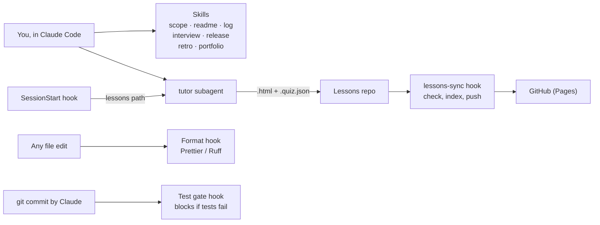

# claude-dev-toolkit

> A Claude Code plugin that turns my way of working into reusable tools: scope a project, learn what I build, document it, practise the interview, and release it.

<!-- TODO: demo GIF (30-60 s) of scope-project turning a vague idea into a REQUIREMENTS.md. Record it (e.g. ScreenToGif), save it as docs/demo.gif, then replace this comment with:  -->


## Install

In Claude Code:

```
/plugin marketplace add E54Sacha/claude-dev-toolkit
/plugin install claude-dev-toolkit@claude-dev-toolkit
```

Restart Claude Code. To use the `tutor` lessons, run `/claude-dev-toolkit:setup-lessons` once.

## Features

| | What it does | How to use it |
|---|---|---|
| 📘 **`scope-project`** skill | Turns a vague idea into a `REQUIREMENTS.md`: asks grouped questions, pushes back when the scope doesn't fit your time, then writes a day-by-day plan. | *"I have an idea for a website"* |
| 🤖 **`tutor`** subagent | Teaches any topic, from your project's code to maths or chemistry, in a short illustrated web page with a quiz, and saves it to your lessons repo. | *"Explain how this works"*, *"teach me about matrices"* |
| 📘 **`write-readme`** skill | Writes a portfolio-ready README from a template, using only what exists in the code, and asks before overwriting. | *"Write a README for this repo"* |
| 📘 **`learning-log`** skill | Proposes what you learned in the session, and appends the entries you keep to `LEARNINGS.md`. | *"Let's wrap up, log what I learned"* |
| 📘 **`interview-prep`** skill | Mock interview on your own project: 10 questions one at a time, each answer graded, then a score and topics to revise. | *"Test me on this project"* (add `harder` for mid-level) |
| 📘 **`release-checklist`** skill | Tests, version bump, changelog, commit, tag, push, and it stops for your OK before anything public. Only starts from its slash command. | `/claude-dev-toolkit:release-checklist` |
| 📘 **`retro`** skill | End-of-project retrospective: finds what you had to repeat or what kept breaking, and turns each into a toolkit change (saved in `RETRO.md`, optionally as GitHub issues). | *"Let's do a retro"* |
| 📘 **`add-project-to-portfolio`** skill | Writes or updates a finished project's card on my portfolio site (pitch, proof metrics, tech, links, in English and French), suggests a resume bullet and the repo description, then builds and pushes the site. Made for my own portfolio. | *"Add this project to my portfolio"* |
| 📘 **`setup-lessons`** skill | Creates your lessons repo from a template, or connects an existing one. | `/claude-dev-toolkit:setup-lessons` |
| 🪝 **Format hook** | After every edit, formats the file with the project's own Prettier (JS, TS, JSON, CSS, Markdown…) or Ruff (Python). Does nothing if they aren't installed. | Automatic |
| 🪝 **Test gate** hook | Before Claude runs `git commit`, runs the repo's tests (pytest with the folder's own `.venv`, `npm test`) at the root and one level down; if they fail, the commit is blocked and Claude gets the failing output. No tests found: the commit goes through. | Automatic, on every commit |
| 🪝 **`lessons-sync` hook** | Checks every new lesson's quiz, rebuilds the lessons home page, then commits and pushes the lesson. A broken quiz is never published. | Automatic |

Example of lessons made with `tutor`: [e54sacha.github.io/lessons](https://e54sacha.github.io/lessons/).

## Architecture



**Skills** are instructions Claude loads into the conversation when your message matches their description. **`tutor`** is a subagent: a separate Claude with its own memory and only file tools (no shell), so it can't run commands. **Hooks** are scripts Claude Code runs by itself on an event: after each edit (format, lessons-sync) and when a session starts (tells Claude where your lessons repo is).

## Run it locally

**Requirements:** [Claude Code](https://claude.com/claude-code), Node.js 18+ and Git. Optional: Prettier in your projects, Ruff for Python, the GitHub CLI (`gh`) to publish lessons.

To work on the plugin itself:

```bash
git clone https://github.com/E54Sacha/claude-dev-toolkit.git
cd claude-dev-toolkit
node --test tests/          # 19 tests: quiz checks, format hook, lessons setup
```

Then, in Claude Code, install it from your local folder: `/plugin marketplace add ./claude-dev-toolkit` and `/plugin install claude-dev-toolkit@claude-dev-toolkit`, and restart.

## Project structure

```
.claude-plugin/          # plugin.json (the plugin) + marketplace.json (makes the repo installable)
skills/<name>/SKILL.md   # one folder per skill (+ templates and scripts it uses)
agents/tutor.md          # the tutor subagent
hooks/hooks.json         # which scripts run on which event
hooks/*.mjs              # format, lessons-sync, session-start and their helpers
templates/lessons-repo/  # starter lessons repo used by setup-lessons
tests/                   # node --test, no dependencies
PLAN.md                  # how this toolkit was planned and built, step by step
```

## What I learned

- **Skill vs subagent vs hook:** a skill is instructions loaded into the main chat when its description matches; a subagent is a separate Claude with its own memory and tools that sends back one report; a hook is a command Claude Code runs by itself on an event.

## What I'd do differently

- The format hook trusts each project's own Prettier, which means running code that comes with the project. An opt-in per project would be safer for untrusted repos.
- Lessons depend on CDNs for icons and formulas; bundling them would make the pages work offline.
- The Ruff path of the format hook is covered by tests but hasn't been tried with a real Ruff install yet.

## License

[MIT](LICENSE) © 2026 E54Sacha
